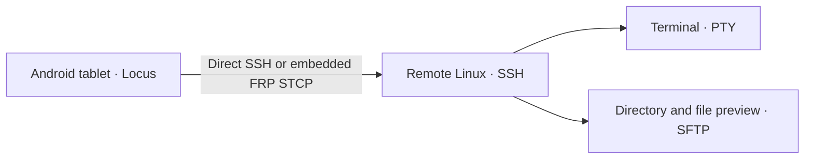

<h1 align="center">Locus</h1>

<p align="center">A terminal-first remote workspace for Android tablets.</p>

<p align="center">
  
  
  <a href="./LICENSE"></a>
</p>

<p align="center">
  <a href="./README.md">English</a> |
  <a href="./README_zh.md">简体中文</a>
</p>

---

## Overview

Locus connects an Android tablet to a remote Linux host. Choose a directory, open a native terminal, and run your shell, editor, OpenCode, or another CLI/TUI. Open more windows for independent PTYs or switch any window to read-only remote file browsing.



## Why Locus?

- **Native terminal input.** Use the Android IME for Chinese composition and a hardware keyboard for terminal and workspace shortcuts. Committed text goes to the remote PTY.
- **Directory-first workflow.** Pick a remote folder with a touch-friendly browser and filter the current listing. Switch between the terminal and file browser in the same window.
- **Flexible tablet layout.** Dock windows on four sides, resize or swap them, put live windows on the shelf, and save split layouts for reuse.
- **Two ways to reach SSH.** Connect directly or import one STCP visitor from your existing FRP TOML. Locus starts that visitor when connecting, and the remote SSH server authenticates your account.
- **Android UI.** Compact edge controls follow the system light or dark theme. Choose English, Simplified Chinese, or the system default. [Samsung One UI design system](https://developer.samsung.com/one-ui/index.html)

## Quick Start

**1. Build and install**

Install the [build requirements](#requirements), then run these commands from the repository root on Windows.

```powershell
.\frp-engine\build.ps1
.\gradlew.bat :app:assembleDebug :app:lintDebug
adb install -r app/build/outputs/apk/debug/app-debug.apk
```

On macOS or Linux, use `pwsh ./frp-engine/build.ps1` and `./gradlew`. The default APK includes `arm64-v8a` and `x86_64`. To build architecture-specific APKs alongside the universal APK, add `-PlocusAbiApks=true` to `:app:assembleDebug`. Use the arm64 APK for a Galaxy Tab S7 or the x86_64 APK for an x86_64 emulator.

**2. Connect**

Open **Workspace actions → Connect**. Enter a host and port for **Direct SSH**, or choose **Import FRP profile** under **FRP STCP** and select your visitor TOML through the system picker. If it contains more than one STCP visitor, select the one that leads to your SSH server.

Enter the SSH username and choose either **Password** or **SSH key**. Use **Choose SSH key** to select a private key through the system picker. You can opt in to saving an encrypted copy of the key, the password, or the key passphrase for reuse. **Connection setup** lets you change the connection and forget remembered values.

> [!IMPORTANT]
> Compare the first connection’s SSH host fingerprint with a trusted value from the server administrator before selecting **Trust host**. A changed key blocks the connection.

**3. Choose a remote directory**

Browse or filter the current folder list, then select **Use this directory**. The up arrow opens the parent, and the home icon opens the remote account’s home. On a later launch, tap the empty window to reconnect with saved credentials and open a fresh shell in the last explicitly selected directory.

**4. Work across windows**

Choose **New window**, then tap a highlighted side of the window you want to split. Drag the shared divider to resize. Its menu also offers **Minimize**, **Swap sides**, and **Save layout**.

Tap the bottom grip to open **Window options**. **Browse files** opens the selected directory and previews text or supported images. Common source files use syntax highlighting. **Terminal** returns to the existing session. The focused window has a blue grip. Press **Ctrl+Alt+Arrow** to move focus in that direction.

The **Window shelf** contains minimized windows and saved layouts. Opening a saved layout restores each window's working folder and browser folder for the matching SSH host and account. Long-press a minimized window to preview it. To restore it, tap its entry and then a highlighted edge. Use **Rename window** to label it on the shelf.

Hold and drag a workspace control or window grip to reposition it. **Workspace actions → Enable free-floating controls** lets you place controls away from an edge. Tap outside a menu or press Back to dismiss it. The **Keyboard** action toggles the Android keyboard and **Close window** asks for confirmation if the terminal channel is still live.

## Connection Reference

| Option | Behavior |
| --- | --- |
| Direct SSH | Host, port, and SSH login. **Options → Import from OpenSSH config** can fill the host, port, and username from an alias. |
| FRP STCP | Imports one `[[visitors]]` entry, starts the embedded client, then authenticates to the remote SSH server. Supports TCP and KCP relay transport with TLS and token authentication. |
| OpenSSH username import over FRP | **Options → Import username from OpenSSH config** fills the username. The imported FRP profile supplies the route. |
| Saved credentials | The imported route and opted-in SSH secrets are encrypted in app-private storage using Android Keystore. |
| Session recovery | A lost connection leaves the window available to reconnect. Reconnecting opens a new PTY. |

The OpenSSH importer reads literal settings. `Include`, `Match`, and proxy routing are outside its scope. The FRP relay and the proxy that serves SSH run on their existing hosts. Android’s document picker can browse files exposed by Termux, including `.ssh` with **Show hidden files** enabled. [FRP STCP example](https://gofrp.org/en/docs/examples/stcp/)

## File Structure

```text
Locus/
├── app/          Android UI, SSH/SFTP, native terminal and instrumentation
├── frp-engine/   Embedded FRP visitor and Android library build
├── tools/        Disposable relay fixtures and host-side smoke checks
├── DESIGN.md     Product constraints and prototype acceptance criteria
├── LICENSE       Mozilla Public License 2.0
├── README.md     English
└── README_zh.md  Simplified Chinese
```

## Requirements

- Android 9 or newer on an arm64 or x86_64 device. The UI is designed for tablets.
- A reachable Linux SSH server with SFTP enabled. For FRP STCP, provide your existing relay, proxy, and visitor configuration.
- To build, use PowerShell 7, Go 1.26, JDK 17 or 21, Android SDK Platform 34, Build Tools 34.0.0, and Android NDK 27. Set `ANDROID_HOME` and put `go` on `PATH`. The wrapper pins Gradle 8.7 and verifies its distribution checksum.

## Development and Verification

Run `:app:lintDebug` and exercise affected screens in English and Simplified Chinese. On a disposable API 33+ device, `adb shell cmd locale set-app-locales dev.locus.app --locales zh-Hans-CN` changes the app locale. Repeat with `en-US` and an unsupported locale when changing language handling. English is the fallback. [Android localization](https://developer.android.com/guide/topics/resources/localization) [Per-app language preferences](https://developer.android.com/guide/topics/resources/app-languages)

For connection troubleshooting with a debug build, run `adb logcat -v threadtime -s LocusDiag:I` and reproduce the problem. Compare the lifecycle, session, and handshake stages under the same attempt ID. Diagnostics are emitted to Logcat and omit connection identities, credentials, fingerprints, paths, and terminal output.

<details>
<summary>Reproducible smoke checks</summary>

**Terminal and IME**

```powershell
.\gradlew.bat :app:assembleDebug :app:assembleDebugAndroidTest
adb install -r app/build/outputs/apk/debug/app-debug.apk
adb install -r -t app/build/outputs/apk/androidTest/debug/app-debug-androidTest.apk
adb shell am instrument -w dev.locus.app.test/dev.locus.app.TerminalSmoke
```

The runner checks Android `InputConnection` callbacks, terminal bytes, canvas rendering, and resizing. To exercise a real Pinyin IME, run `cat` in a disposable SSH shell, type Pinyin without picking a candidate, then choose the candidate and press Enter. Verify that only the committed text reaches the host. Repeat when moving focus between panes and in the installed TUI.

**Embedded FRP**

From `frp-engine`, run `go test -count=1 -v ./...`. To enable the live relay check, set `LOCUS_FRP_TEST_FIXTURE` to a disposable fixture JSON with `relayHost`, `relayPort`, `relayToken`, `serverName`, and `secretKey`. Set `relayProtocol` to `kcp` to use an enabled KCP UDP listener. The default is TCP. Use an STCP proxy that leads to SSH and keep the fixture outside the repository.

**SSH and delayed banners**

On a disposable Linux SSH test account, create the following entries in its home directory. Add a small PNG named `fixture.png`.

```sh
printf '%s\n' fixture > 'preview*?.txt'
printf '%s\n' 中文 > '中文.txt'
mkdir "select quote';[]"
ln -s 'preview*?.txt' preview-link.txt
```

Use the JSch and Bouncy Castle JAR versions pinned in `app/build.gradle`. Set `LOCUS_TEST_PASSWORD` in the test process environment and obtain the server’s fingerprint independently.

```powershell
$jsch = 'path-to-jsch.jar'
$bc = 'path-to-bcprov.jar'
$classes = 'path-to-test-classes'
$sshServer = 'your-test-host'
$fingerprint = 'SHA256:your-fingerprint'
javac --release 11 -encoding UTF-8 -cp $jsch -d $classes app/src/main/java/dev/locus/app/OperationException.java app/src/main/java/dev/locus/app/RemoteConnection.java app/src/main/java/dev/locus/app/SshConnection.java tools/SshSmoke.java tools/SshBannerDelaySmoke.java
java '-Djdk.util.jar.enableMultiRelease=false' -cp "$classes;$jsch;$bc" dev.locus.app.SshSmoke $sshServer 22 test-user new-pins.properties $fingerprint
java '-Djdk.util.jar.enableMultiRelease=false' -cp "$classes;$jsch;$bc" dev.locus.app.SshBannerDelaySmoke
```

Use `:` as the classpath separator on macOS/Linux. For key login, set `LOCUS_TEST_KEY_FILE` and, for an encrypted key, `LOCUS_TEST_PASSPHRASE`. For changed-key rejection, change the disposable server’s host key and repeat with the same pins file and `changed` as the last argument. The delayed-banner smoke starts its own loopback fixture and needs no SSH credentials or relay.

</details>

## License

This Source Code Form is subject to the terms of the Mozilla Public License, v. 2.0. This notice applies to Locus’s original source. Get a copy in [LICENSE](./LICENSE) or from [Mozilla](https://www.mozilla.org/MPL/2.0/).

Bundled components can be distributed with Locus under their respective terms. The vendored Termux terminal Java code and text selection drawables use Apache-2.0, as do the Gradle wrapper scripts and JAR. The checked-in notices cover the Termux terminal, character-width tables, JSch, Bouncy Castle, and the Android NDK startup objects linked into the FRP library. The FRP build adds notices for the Go runtime and all linked Go modules. [Third-party notices](./app/src/main/assets/licenses/) · [FRP build](./frp-engine/build.ps1)

Distribution of an APK requires making the corresponding Locus source available. The APK includes the license and source reference for the unmodified Yamux dependency. [MPL-2.0, sections 3.2 and 3.3](https://www.mozilla.org/en-US/MPL/2.0/) · [Yamux 0.3.0 source](https://github.com/fatedier/yamux/tree/v0.3.0)

Open **Workspace actions → About Locus** and choose **Project license** or **Third-party licenses** to read the notices offline.

Project source and maintainer · [Dqz00116/Locus](https://github.com/Dqz00116/Locus) · [@Dqz00116](https://github.com/Dqz00116)
