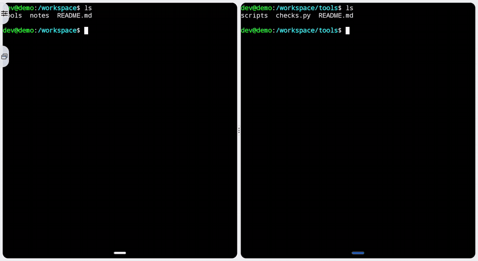
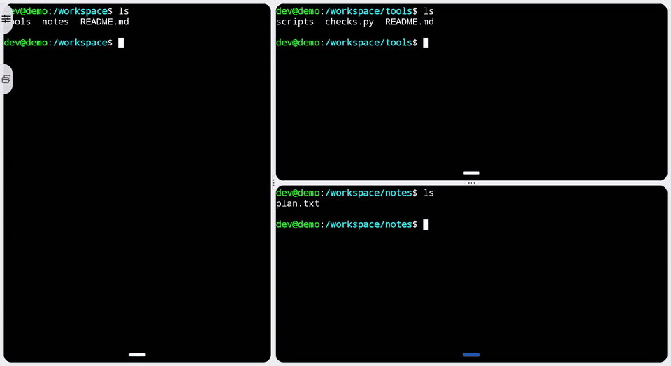
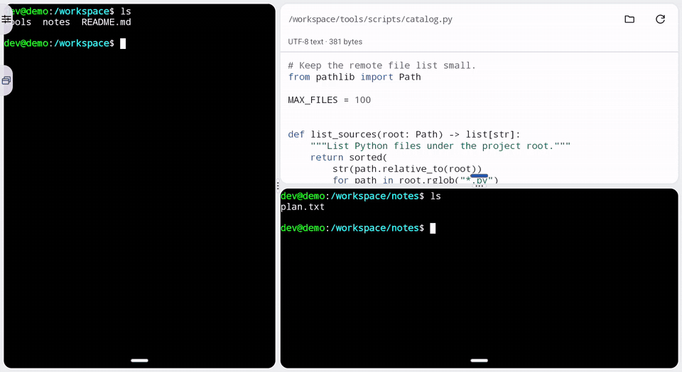
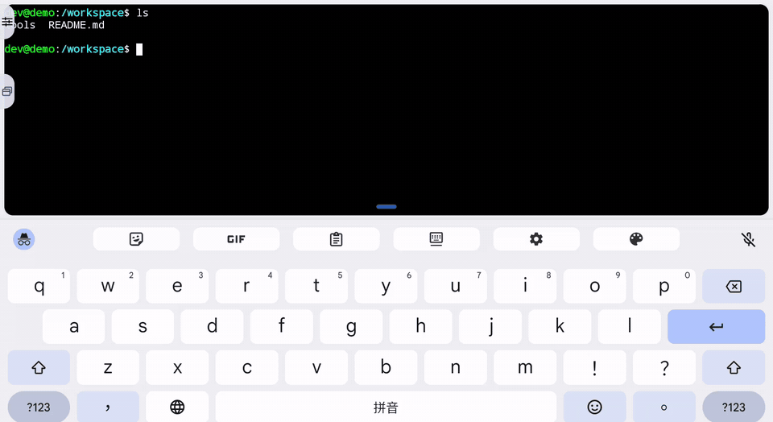
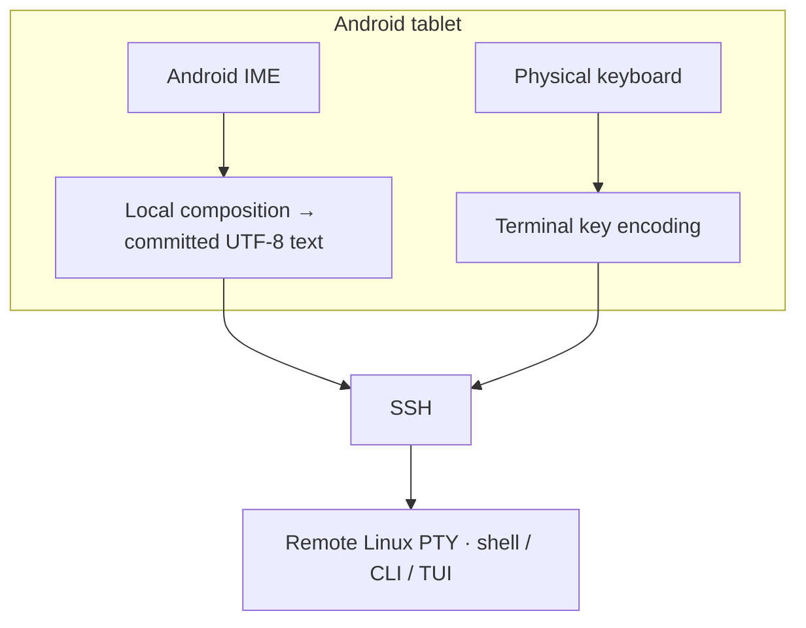

<p align="center">
  
</p>

<h1 align="center">Locus</h1>

<p align="center"><strong>Your Linux workspace, on your Android tablet.</strong></p>
<p align="center">SSH terminal, split windows, and remote file preview.</p>

<p align="center">
  <a href="https://github.com/Dqz00116/Locus/releases"></a>
  
  <a href="./LICENSE"></a>
</p>

<p align="center">
  <a href="./README.md">English</a> |
  <a href="./README_zh.md">简体中文</a>
</p>

---

Locus is an Android client for remote Linux work. Connect to your host, pick a working directory, and use the shell and command-line tools installed there. Keep independent shells and your remote files in one tablet workspace.

Compose text with your Android IME and use a physical keyboard for terminal keys and shortcuts.

## See Locus in action

### Dock and resize windows

Pick an edge to place another terminal, then drag a divider to give each pane the space it needs.



### Preview remote files

Browse folders over SFTP and open a read-only preview alongside your terminal. Common source files get syntax highlighting. Supported images can also be previewed.



### Save and reopen layouts

Save a window arrangement with each pane’s directory and reopen it from the sidebar.



### Type Chinese in the terminal

Compose with Android’s Pinyin keyboard. Selecting `你好` sends the committed text to the remote terminal.



## Quick Start

**1. Install and open Locus.** Get the APK from [GitHub Releases](https://github.com/Dqz00116/Locus/releases) or build it from source. Use an arm64 or x86_64 device running Android 9 or later and a Linux host with SSH and SFTP enabled.

<details>
<summary>Build and install from source</summary>

Install Go 1.26 or later, JDK 17 or 21, Android SDK Platform 34, Build Tools 34.0.0, Platform Tools, and Android NDK 27. Set `JAVA_HOME` and `ANDROID_HOME`, and add `go` and `adb` to your `PATH`.

From the repository root, run `gradlew.bat :app:assembleDebug` in Windows Command Prompt or `./gradlew :app:assembleDebug` on macOS or Linux. Gradle builds and packages the bundled FRP library automatically.

Connect your Android device to ADB and install the built APK.

```text
adb install -r app/build/outputs/apk/debug/app-debug.apk
```

To generate per-architecture APKs alongside the universal APK, add `-PlocusAbiApks=true` to the Gradle command.

</details>

**2. Connect to the host.** Open **Workspace actions → Connect**, then select a route.

- **Direct SSH** if the tablet can reach the host over its network. Enter the SSH host or IP address and port.
- **FRP STCP** if you already reach SSH through an FRP relay. Import the visitor TOML and select the STCP visitor that points to your SSH service. Locus runs the built-in visitor when you connect. [FRP STCP example](https://gofrp.org/en/docs/examples/stcp/)

Both routes use the remote host’s SSH username and either a **Password** or an **SSH key**. Use the Android file picker to select your private key. On first connection, compare the displayed SSH fingerprint with one supplied by your server administrator before choosing **Trust host**.

**3. Pick a working directory.** Browse or filter folders, then tap **Use this directory** to open a shell there. Use **New window** to add another terminal, or tap the window’s bottom grip and choose **Browse files** to open the selected folder.

## How terminal input works

Android handles composition and candidate selection on the tablet. Locus sends committed text as UTF-8 and encodes terminal keys before forwarding them to the remote shell or text-based application.


