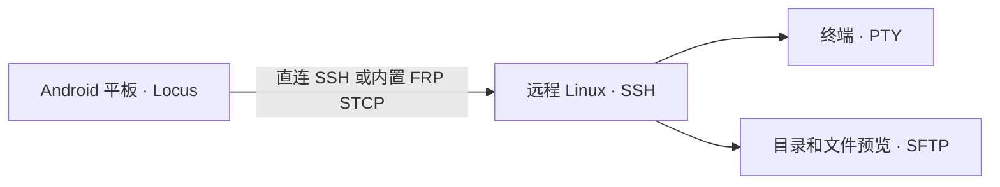

<h1 align="center">Locus</h1>

<p align="center">面向 Android 平板的远程终端工作区。</p>

<p align="center">
  
  
  <a href="./LICENSE"></a>
</p>

<p align="center">
  <a href="./README.md">English</a> |
  <a href="./README_zh.md">简体中文</a>
</p>

---

## 概览

Locus 将 Android 平板连接到远程 Linux 主机。选好远程目录后，可以在原生终端里使用 Shell、编辑器、OpenCode 或其他命令行与字符界面工具。每个窗口都能打开独立的 PTY，也能切换为只读文件浏览。



## 为什么用 Locus？

- **原生终端输入。** 使用 Android 输入法连续输入中文，也可用实体键盘操作终端和切换窗口焦点。确认后的文字会发送到远程 PTY。
- **先选目录，再开始工作。** 通过触控浏览远程目录，筛选当前目录下的文件夹，在同一个窗口中切换终端和文件浏览。
- **为平板优化的多窗口。** 窗口可挂载在四个方向，拖动分隔柄调整尺寸，交换两侧位置，将运行中的窗口最小化到侧边栏，或收藏分屏布局以便复用。
- **两种 SSH 连接方式。** 可以直连 SSH，也可以导入 FRP TOML 中的 STCP 访问端。连接时 Locus 启动内置访问端，SSH 账户由远程主机验证。
- **原生 Android 界面。** 紧凑的贴边控件随系统切换浅色或深色主题。界面语言可选英文、简体中文或跟随系统。[Samsung One UI 设计系统](https://developer.samsung.com/one-ui/index.html)

## 快速开始

**1. 构建并安装**

安装[构建所需工具](#运行与构建要求)后，在 Windows 上从仓库根目录运行以下命令。

```powershell
.\frp-engine\build.ps1
.\gradlew.bat :app:assembleDebug :app:lintDebug
adb install -r app/build/outputs/apk/debug/app-debug.apk
```

macOS 和 Linux 使用 `pwsh ./frp-engine/build.ps1` 与 `./gradlew`。默认 APK 同时支持 `arm64-v8a` 和 `x86_64`。如需同时生成按架构拆分的 APK，在 `:app:assembleDebug` 后加上 `-PlocusAbiApks=true`。Galaxy Tab S7 使用 arm64 APK，x86_64 模拟器使用 x86_64 APK。

**2. 连接 SSH 主机**

打开**工作区操作 → 连接**。选择**直连 SSH**时，输入主机和端口。选择 **FRP STCP** 时，点**导入 FRP 配置**，通过系统文件选择器选择访问端 TOML。配置存在多个 STCP 访问端时，选择通往 SSH 主机的那一项。

输入 SSH 用户名，然后选择**密码**或 **SSH 密钥**。点**选择 SSH 密钥**可在系统文件选择器中选择私钥。可按需在平板上加密保存密钥副本、密码或密钥口令。需要修改连接或移除保存的凭据时，打开**连接设置**。

> [!IMPORTANT]
> 首次连接时，先向主机管理员核对 SSH 指纹，再选择**信任主机**。已信任主机的密钥发生变更时，连接会被阻止。

**3. 选择远程目录**

浏览或筛选当前目录的文件夹，然后选择**使用此目录**。点击向上箭头返回上一级目录，点击主页图标返回远程账户的主目录。下次启动应用后，可点击空窗口，使用已保存的凭据重连，并在最近一次主动选择的目录中打开新 Shell。

**4. 使用多窗口**

点**新建窗口**，再点目标窗口高亮的边。拖动共享分隔柄可调整大小。点击分隔柄还可以**最小化**、**交换两侧窗口**或**收藏布局**。

点击窗口底部短柄打开**窗口选项**。用**浏览文件**进入所选目录，预览文本和支持的图片。常见源码文件支持语法高亮。点**终端**回到原会话。当前焦点窗口的短柄为蓝色，按 **Ctrl+Alt+方向键**可切换焦点。

**窗口侧边栏**显示最小化窗口和收藏布局。在匹配的 SSH 主机和账号上，打开收藏同时恢复每个窗口的工作目录和文件浏览目录。长按最小化窗口可预览，轻点条目后选择高亮边缘可重新挂载。通过**重命名窗口**更改它在侧边栏中的显示名称。

长按并拖动工作区控件或窗口短柄可以移动位置。打开**工作区操作 → 开启控件自由悬浮**，即可将控件放在远离侧边的位置。点击菜单外侧或按返回键可收起菜单。**键盘**切换虚拟键盘，活动终端通道还在运行时，**关闭窗口**会先要求确认。

## 连接参考

| 选项 | 行为 |
| --- | --- |
| 直连 SSH | 需要主机、端口和 SSH 登录信息。可在用户名旁选择**选项 → 从 OpenSSH 配置导入**，通过别名填写主机、端口及用户名。 |
| FRP STCP | 导入一个 `[[visitors]]` 条目，连接时启动内置访问端，再由远程主机验证 SSH 登录。支持 TCP、KCP、TLS 和令牌认证。 |
| FRP 模式下导入 SSH 用户名 | **选项 → 从 OpenSSH 配置导入用户名**可填写用户名，路由仍来自导入的 FRP 配置。 |
| 保存凭据 | 导入的路由和主动选择保存的 SSH 凭据通过 Android Keystore 加密，保存在应用私有目录。 |
| 断线重连 | 窗口保留并提供重连入口。重连后会打开新的 PTY。 |

OpenSSH 导入读取配置中的字面设置。`Include`、`Match` 和代理路由超出当前导入范围。FRP 中继和代理继续在原有主机上运行。已有文件位于 Termux 时，可以在 Android 文件选择器里打开该位置，并开启**显示隐藏文件**以查找 `.ssh`。[FRP STCP 示例](https://gofrp.org/en/docs/examples/stcp/)

## 目录结构

```text
Locus/
├── app/          Android 界面、SSH/SFTP、原生终端和插桩测试
├── frp-engine/   内置 FRP 访问端和 Android 库构建
├── tools/        临时中继测试环境和主机端冒烟测试
├── DESIGN.md     产品约束和原型验收标准
├── LICENSE       Mozilla Public License 2.0
├── README.md     英文
└── README_zh.md  简体中文
```

## 运行与构建要求

- 设备需运行 Android 9 或更高版本，支持 arm64 或 x86_64。界面以平板为主要目标。
- Linux 主机需提供可连接的 SSH 和 SFTP。使用 FRP STCP 时，需准备已有的中继、代理和访问端配置。
- 构建需要 PowerShell 7、Go 1.26、JDK 17 或 21、Android SDK Platform 34、Build Tools 34.0.0 以及 Android NDK 27。设置 `ANDROID_HOME`，将 `go` 加入 `PATH`。项目使用 Gradle Wrapper 固定 Gradle 8.7 并校验发行包。

## 开发与验证

运行 `:app:lintDebug`，并用英语和简体中文验证受影响的界面。可以在临时 API 33+ 设备上用 `adb shell cmd locale set-app-locales dev.locus.app --locales zh-Hans-CN` 切换应用语言。改动语言处理时，再检查 `en-US` 和一个当前未提供翻译的语言。未匹配时回退到英文。[Android 本地化](https://developer.android.com/guide/topics/resources/localization) [应用语言设置](https://developer.android.com/guide/topics/resources/app-languages)

排查连接问题时，用调试 APK 复现并运行 `adb logcat -v threadtime -s LocusDiag:I`，按同一尝试 ID 对照生命周期、会话和握手阶段。日志写入 Logcat，省去连接身份、凭据、指纹、路径和终端输出等字段。

英文 README 的[开发与验证](./README.md#development-and-verification)包含终端输入、FRP、SSH 和握手超时的可复现命令。

## 许可证

Locus 的原创源代码采用 Mozilla Public License 2.0（MPL-2.0）。完整文本见仓库 [LICENSE](./LICENSE) 和 [Mozilla 官网](https://www.mozilla.org/MPL/2.0/)。

第三方组件可在保留各自许可的前提下随 Locus 一起分发。Termux 终端 Java 代码、文本选择绘图资源以及 Gradle Wrapper 启动脚本和 JAR 采用 Apache-2.0。仓库内的声明覆盖 Termux、字符宽度表、JSch、Bouncy Castle 和链接到 FRP 库中的 Android NDK 启动对象。FRP 构建脚本会将 Go 运行时及所有链接的 Go 模块的声明放进 APK。[第三方声明](./app/src/main/assets/licenses/) · [FRP 构建脚本](./frp-engine/build.ps1)

分发 APK 时须提供对应版本的 Locus 源码。APK 内附原样使用的 Yamux 依赖的许可证和源码地址。[MPL-2.0 第 3.2 和 3.3 节](https://www.mozilla.org/en-US/MPL/2.0/) · [Yamux 0.3.0 源码](https://github.com/fatedier/yamux/tree/v0.3.0)

在**工作区操作 → 关于 Locus**中，选择**项目许可证**或**第三方许可证**即可离线查看许可与声明。

项目源码与维护者 · [Dqz00116/Locus](https://github.com/Dqz00116/Locus) · [@Dqz00116](https://github.com/Dqz00116)
