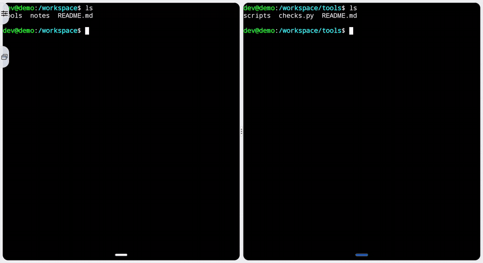
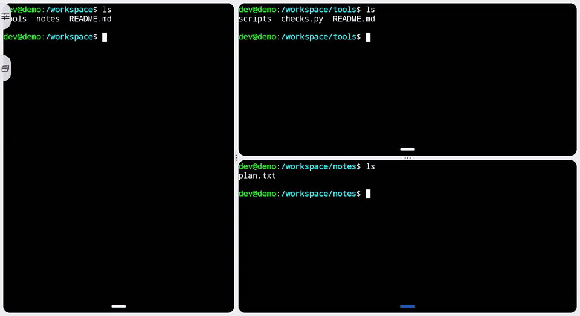
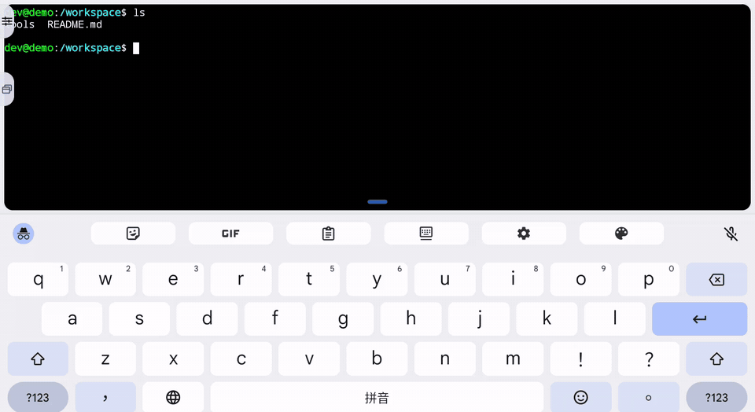
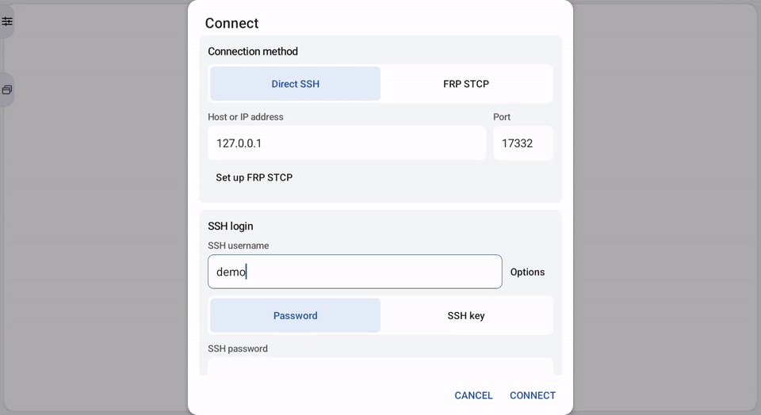
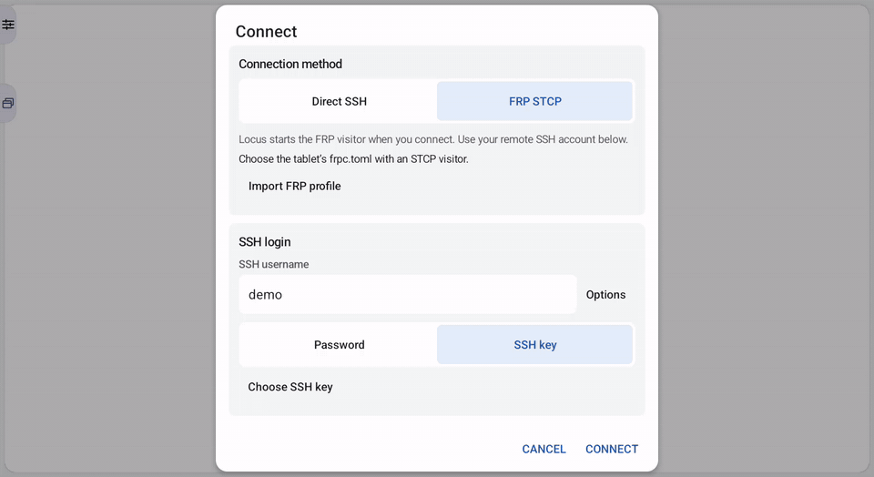

<p align="center">
  
</p>

<h1 align="center">Locus</h1>

<p align="center"><strong>把远程 Linux 工作台带到 Android 平板。</strong></p>
<p align="center">SSH 终端、分屏窗口与远程文件预览。</p>

<p align="center">
  <a href="https://github.com/Dqz00116/Locus/releases"></a>
  
  <a href="./LICENSE"></a>
</p>

<p align="center">
  <a href="./README.md">English</a> |
  <a href="./README_zh.md">简体中文</a>
</p>

---

Locus 是面向 Android 平板的远程 Linux 工作台。通过 SSH 连接主机并选择工作目录，即可运行主机上的 Shell 和终端应用。你可以并排使用多个独立终端和远程文件预览，终端支持 Android 输入法与实体键盘。

[发布版本](https://github.com/Dqz00116/Locus/releases) · [快速开始](#快速开始)

## 功能演示

### 自由分屏

选一条窗口边缘挂载新终端，再拖动分隔柄，为各窗口分配空间。



### 远程文件预览

通过 SFTP 浏览目录，在终端旁打开只读预览。常见源码支持语法高亮，也可预览支持的图片。



### 收藏与恢复布局

收藏窗口布局及各窗口的目录，再从侧边栏打开。


### 终端原生中文输入

用 Android 拼音输入法组词，选中 `你好` 后，确认的文字会发送到远程终端。



## 快速开始

### 1. 安装 Locus

从 [GitHub Releases](https://github.com/Dqz00116/Locus/releases) 下载 APK，也可以从源码构建。使用运行 Android 9 或更高版本的 arm64 或 x86_64 设备，准备一台已启用 SSH 和 SFTP 的 Linux 主机。

<details>
<summary>从源码构建并安装</summary>

安装 Go 1.26 或更高版本、JDK 17 或 21、Android SDK Platform 34、Build Tools 34.0.0、Platform Tools 和 Android NDK 27。设置 `JAVA_HOME` 和 `ANDROID_HOME`，并将 `go` 和 `adb` 加入 `PATH`。

在仓库根目录构建。Windows 命令提示符运行 `gradlew.bat :app:assembleDebug`，macOS 或 Linux 运行 `./gradlew :app:assembleDebug`。Gradle 会自动构建并打包内置的 FRP 库。

通过 ADB 连接 Android 设备，然后安装生成的 APK。

```text
adb install -r app/build/outputs/apk/debug/app-debug.apk
```

需要同时生成按架构拆分的 APK 时，在 Gradle 命令末尾加上 `-PlocusAbiApks=true`。

</details>

### 2. 连接主机

打开**工作区操作 → 连接**。如需修改已有连接，断开后打开**连接设置**。

#### 直连 SSH

平板能直接访问 SSH 主机时，选择**直连 SSH**。填写主机名或 IP 地址、端口（通常为 `22`）和 SSH 用户名。选择**密码**后输入账户密码，或选择 **SSH 密钥**，通过 Android 文件选择器选取私钥。点**连接**。



#### FRP STCP

已有 FRP 中继和通往 SSH 主机的 STCP 代理时，选择 **FRP STCP**。点**导入 FRP 配置**，在 Android 文件选择器里选取访问端的 `frpc.toml`。只有一个已启用的 STCP 访问端时，Locus 会自动选中。存在多个时，选择通往 SSH 的那一个。填写目标主机的 SSH 用户名，使用该账户的密码或私钥登录，再点**连接**。Locus 按导入的配置启动内置访问端。



<details>
<summary>使用令牌认证的 FRP 访问端 TOML 示例</summary>

```toml
serverAddr = "frp.example.com"
serverPort = 7000
auth.method = "token"
auth.token = "REPLACE_WITH_RELAY_TOKEN"
transport.tls.enable = true

[[visitors]]
name = "ssh-visitor"
type = "stcp"
serverName = "ssh-proxy"
secretKey = "REPLACE_WITH_STCP_SECRET"
```

填入 FRP 中继的地址、端口与令牌。`serverName` 填 STCP 代理名称，`secretKey` 与该代理的共享密钥一致。SSH 登录使用目标主机上的账户。中继和代理的部署见 [FRP 官方 STCP 示例](https://gofrp.org/en/docs/examples/stcp/)。

</details>

### 3. 打开工作目录

首次连接时，先向主机管理员核对界面显示的 SSH 指纹，再选**信任主机**。浏览或筛选文件夹，点**使用此目录**打开 Shell。点**新建窗口**可添加终端，点窗口底部短柄后选择**浏览文件**可查看目录内容。
