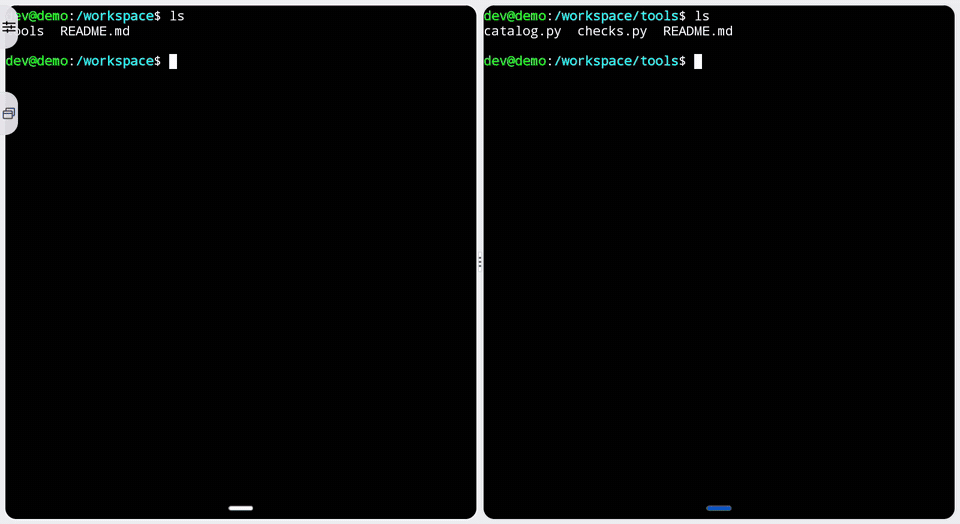
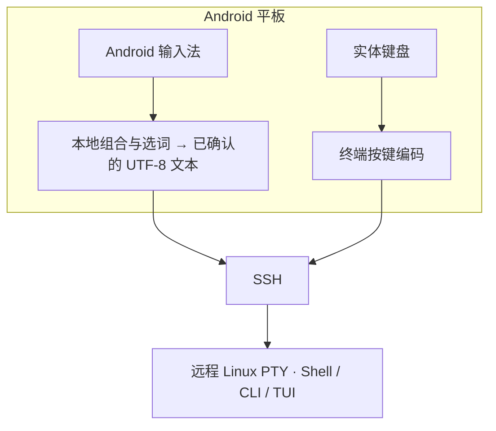

<p align="center">
  
</p>

<h1 align="center">Locus</h1>

<p align="center"><strong>把远程 Linux 工作台带到 Android 平板。</strong></p>
<p align="center">SSH 终端、分屏窗口与远程文件预览。</p>

<p align="center">
  <a href="https://github.com/Dqz00116/Locus/releases"></a>
  
  <a href="./LICENSE"></a>
</p>

<p align="center">
  <a href="./README.md">English</a> |
  <a href="./README_zh.md">简体中文</a>
</p>

---

Locus 是用于远程 Linux 工作的 Android 客户端。连接主机，选好工作目录，即可使用主机上的 Shell 和命令行工具。在同一个平板工作区里，可以同时操作多个独立终端、查看远程文件。

<p align="center">
  
</p>

- **原生输入。** 用 Android 输入法输入中文并选词，也可使用实体键盘操作终端和触发快捷键。
- **窗口自由挂载。** 打开独立的 SSH 终端，拖动分隔柄调整大小，收藏分屏布局及各窗口的目录。
- **文件只读预览。** 通过 SFTP 浏览远程目录并预览文本和支持的图片，常见源码支持语法高亮。

## 快速开始

**1. 安装并打开 Locus。** 从 [GitHub Releases](https://github.com/Dqz00116/Locus/releases) 下载 APK，也可以从源码构建。使用运行 Android 9 或更高版本的 arm64 或 x86_64 设备，准备一台已启用 SSH 和 SFTP 的 Linux 主机。

<details>
<summary>从源码构建并安装</summary>

安装 Go 1.26 或更高版本、JDK 17 或 21、Android SDK Platform 34、Build Tools 34.0.0、Platform Tools 和 Android NDK 27。设置 `JAVA_HOME` 和 `ANDROID_HOME`，并将 `go` 和 `adb` 加入 `PATH`。

在仓库根目录构建。Windows 命令提示符运行 `gradlew.bat :app:assembleDebug`，macOS 或 Linux 运行 `./gradlew :app:assembleDebug`。Gradle 会自动构建并打包内置的 FRP 库。

通过 ADB 连接 Android 设备，然后安装生成的 APK。

```text
adb install -r app/build/outputs/apk/debug/app-debug.apk
```

需要同时生成按架构拆分的 APK 时，在 Gradle 命令末尾加上 `-PlocusAbiApks=true`。

</details>

**2. 连接主机。** 打开**工作区操作 → 连接**，选择连接方式。

- **直连 SSH**适用于平板能通过当前网络访问主机的情况。输入 SSH 主机名或 IP 地址及端口。
- **FRP STCP** 适用于已经通过 FRP 中继访问 SSH 的情况。导入访问端 TOML，选择通往 SSH 服务的 STCP 访问端，Locus 会在连接时运行内置访问端。[FRP STCP 示例](https://gofrp.org/en/docs/examples/stcp/)

两种方式都用远程主机的 SSH 用户名登录，认证方式可选**密码**或 **SSH 密钥**。私钥通过 Android 文件选择器选取。首次连接时，先向主机管理员核对 SSH 指纹，再选择**信任主机**。

**3. 选择工作目录。** 浏览或筛选文件夹，点击**使用此目录**即可打开 Shell。要添加终端，点**新建窗口**。要查看该目录的文件，点窗口底部的短柄，再选**浏览文件**。

## 终端输入如何工作

Android 在平板上处理输入法组合与选词。Locus 将确认后的文字编码为 UTF-8，将终端按键编码后一起通过 SSH 送到远程 Shell 或字符界面程序。


